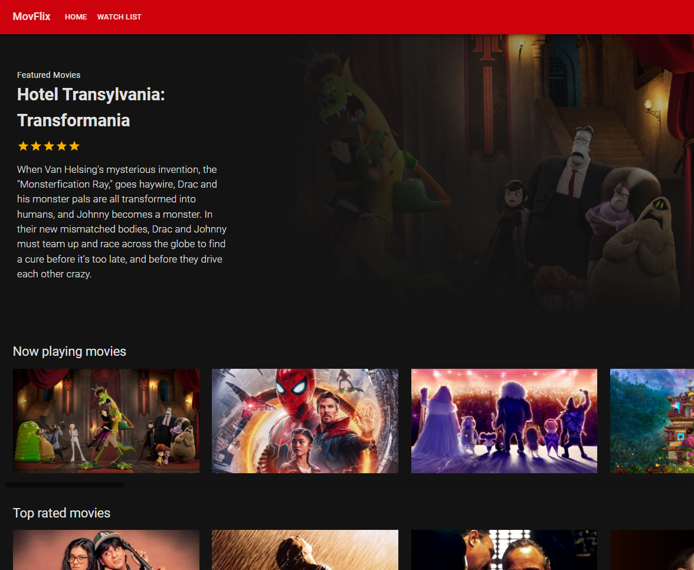
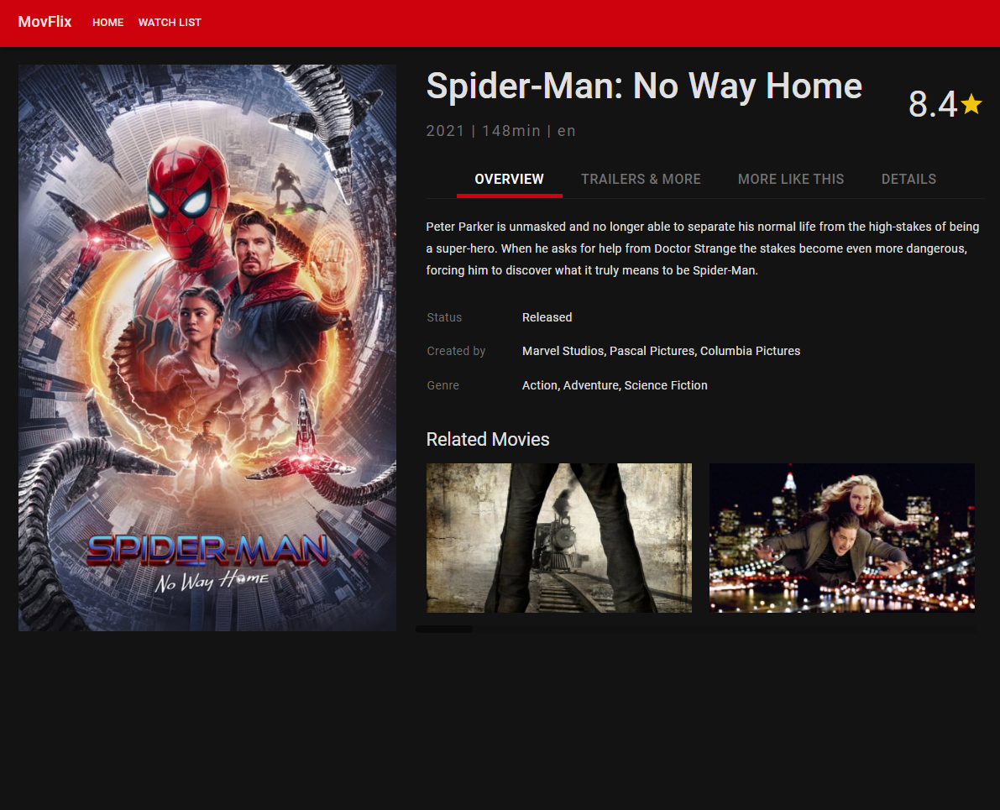
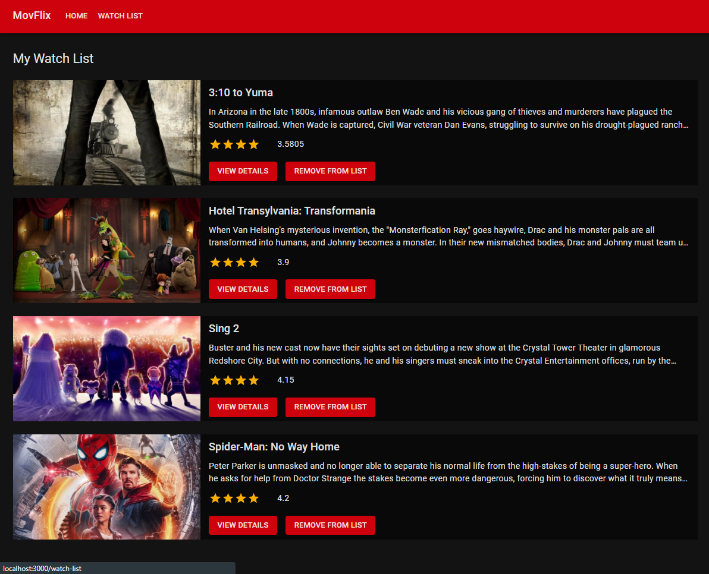

# Movflix

A Netflix-inspired movies and TV shows web application powered by the TMDB (The Movie Database) API.

## Previews

| Dashboard | Movie Detail |
|:---:|:---:|
|  |  |

| Watchlist |
|:---:|
|  |

## Features

- 🎬 **Browse Trending & Popular**: Explore trending movies and popular TV shows.
- 🔍 **Search**: Search movies and series with instant results.
- 📑 **Detailed Info**: View synopsis, ratings, release date, runtime, and cast.
- 📌 **Watchlist**: Save movies and series to your personal watchlist (persisted locally).
- 🌙 **Netflix-Inspired UI**: Responsive dark theme built with Material-UI (MUI v5) and Emotion.

## Tech Stack

- **Framework**: React 17, React Router 6
- **UI Components**: Material-UI (MUI v5), Emotion
- **Data Fetching**: Axios
- **Data Source**: [The Movie Database (TMDB) API](https://www.themoviedb.org/)

## Getting Started

### 1. Setup Environment
```bash
cp .env.example .env
```
Add your TMDB API key to `.env` (a free key can be generated at [themoviedb.org](https://www.themoviedb.org/)):
```env
REACT_APP_TMDB_APIKEY=your_tmdb_api_key
```

### 2. Install Dependencies
```bash
npm install
# or
yarn install
```

### 3. Run Development Server
```bash
npm start
# or
yarn start
```
The app will run locally at [http://localhost:3000](http://localhost:3000).
